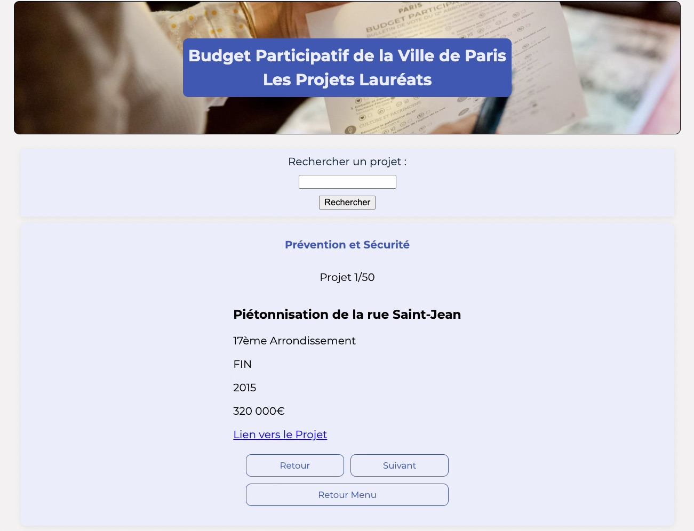

--- ADATAVIZ ---
Recensement des projets lauréats du budget participatif de la ville de Paris.


## Aperçu
<p align = "center">


</p>

## Fonctionnalités

- Menu des thématiques
- Carte projet : nom, arrondissement, avancement, année, budget, lien
- Navigation entre les projets : Retour, Suivant, Retour Menu
- Recherche d'un projet - à venir -


## Sources

Source : Open Data Paris
URL de l'API :
https://opendata.paris.fr/api/explore/v2.1/catalog/datasets/bp_projets_gagnants/records?limit=100


## Menu Thématiques

- Le menu est généré automatiquement via les thématiques des projets, récupérées par l'API.
- Testé en changeant la limite récupérée entre 20 et 100 resultats, le menu s'adapte.
- Chaque thème renvoie vers une selection de projets qui ont la thématique choisie.


## Page Projet

- J'ai opté (pour ce projet) pour 100 projets, pour pouvoir avoir assez de thématiques couvertes (pour 20 projets je n'avais que 5 ou 6 thèmes couverts).
- Chaque projet est détaillé avec :
    - son nom
    - son arrondissement 
    - l'état de son avancement
    - le budget alloué à ce projet
    - un lien qui renvoie vers la page officielle (ville de Paris) du projet


## Menu Navigation (disponible sur la page projets)

- Suivant : Avance jusqu'au dernier projet listé (le compteur en haut de page permet de savoir où l'on se situe)
- Retour : Permet de revenir aux projets précédents (s'arrete au premier projet du tableau)
- Menu : Renvoie à la page principale / Menu thématiques


## Installation et lancement

Prérequis : VS Code, Node.js (pour les tests), l'extension Live Server installée dans VS Code.

Cloner le dépôt :
```bash
git clone https://github.com/rbrochier/adataviz.git
cd adataviz
```

Installer les dépendances (pour les tests) :
```bash
npm install
```

Lancer l'application : ouvrir le dossier du projet dans VS Code, puis lancer Live Server depuis index.html

⚠️ Un double-clic sur index.html ne suffit pas. (ton navigateur préféré ne saura géré les modules en local).


## Structure du projet
adataviz/
├── index.html       
├── style.css        
├── main.js          
├── utils.js         
├── utils.test.js    
├── package.json     
└── README.md


Crédits
Données : Open Data Paris
Photo du header : Ville de Paris
Police : Montserrat, Google Fonts
Auteur

Richard Brochier, Ada Tech School , promotion Hubertine Auclert, 2026 .