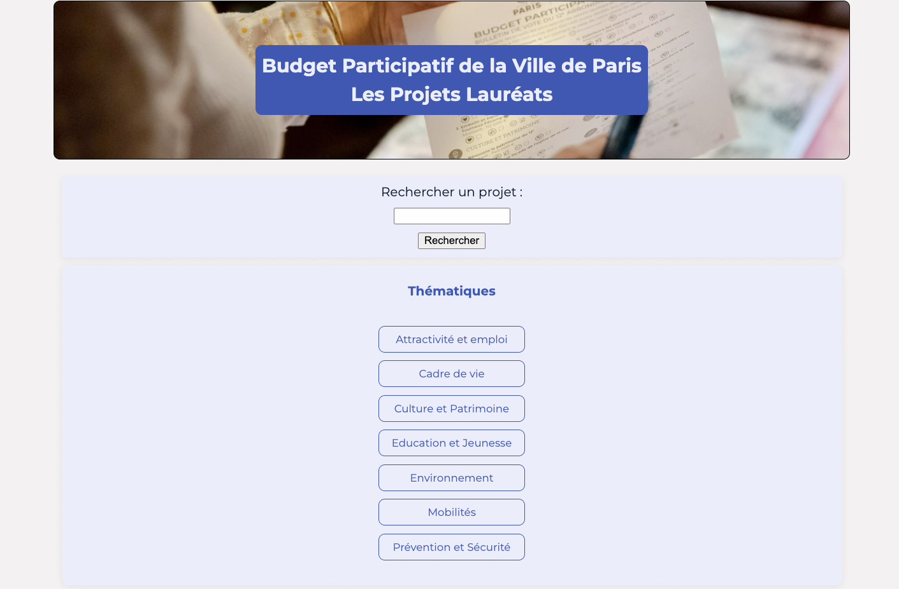

--- ADATAVIZ ---
Recensement des projets lauréats du budget participatif de la ville de Paris.

## Aperçu

## Fonctionnalités

- Menu des thématiques
- Carte projet : nom, arrondissement, avancement, année, budget, lien
- Navigation entre les projets : Retour, Suivant, Retour Menu
- Recherche d'un projet *(à venir)*

## Menu Thématiques

- Le menu est géré automatiquement par les thèmatiques des projets récupérées via l'API.
- Testé en changeant la limite récupérée entre 20 et 100 resultats, le menu s'adapte.

